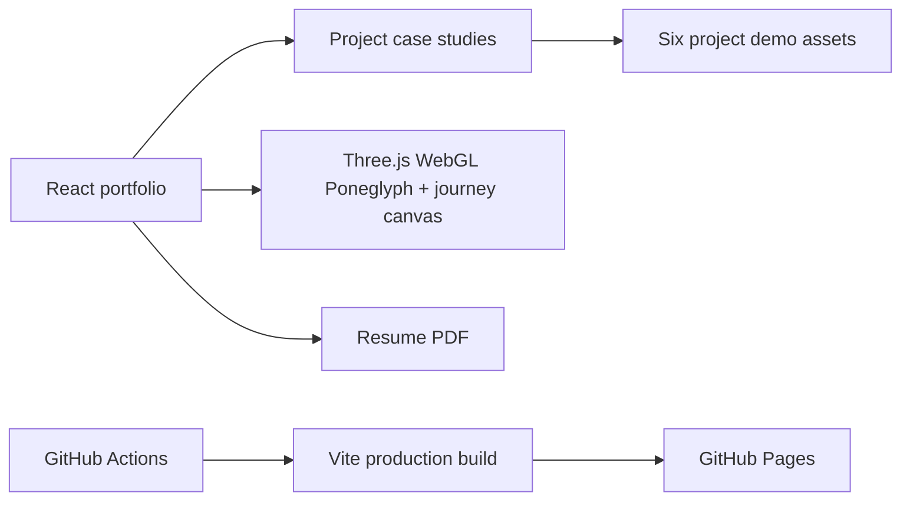

# Nikith Prasad — Developer Portfolio

React, Vite, Tailwind CSS, and Three.js portfolio for [NikithPrasad.github.io](https://nikithprasad.github.io/), with a quiet One Piece / Grand Line visual language, a scroll-morphed WebGL Poneglyph, and six project case studies.

## Run locally

```bash
npm ci
npm run dev
```

Build the production site with `npm run build`. The GitHub Actions workflow builds the site and deploys `dist/` to GitHub Pages on pushes to `main`.

## Architecture



Project performance numbers are reproduced from the individual project READMEs and evaluation reports. Clinical model metrics are presented as research results, not medical advice.
